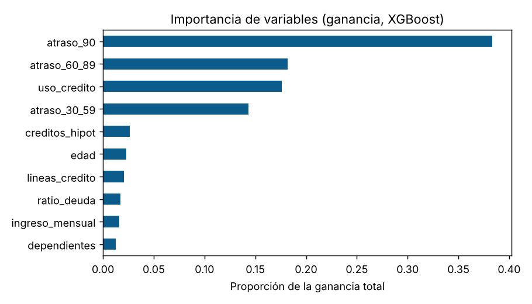

# Riesgo de impago: Give Me Some Credit

Análisis básico de riesgo crediticio con 150.000 clientes (competencia de Kaggle *Give Me Some Credit*): exploración y limpieza, regresión logística con grilla de 80 combinaciones y XGBoost con grilla para obtener la importancia de variables. El análisis en lenguaje simple está en [`reports/analisis.md`](reports/analisis.md).

| Modelo | AUC test | KS test |
|---|---|---|
| Regresión logística | 0,858 | 0,564 |
| XGBoost | 0,867 | 0,588 |

Lo más influyente: haber tenido atrasos previos (71% de la importancia) y el uso de las líneas de crédito (18%).

## Uso
1. Descarga `cs-training.csv` desde [Kaggle](https://www.kaggle.com/competitions/GiveMeSomeCredit/data) y déjalo en `data/`.
2. `pip install -r requirements.txt`
3. Abre `notebooks/01_riesgo_credito.ipynb` y ejecuta todo.

Los datos no se incluyen en el repo por los términos de la competencia.
